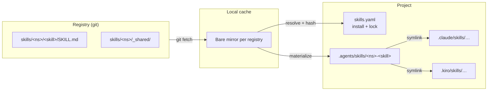
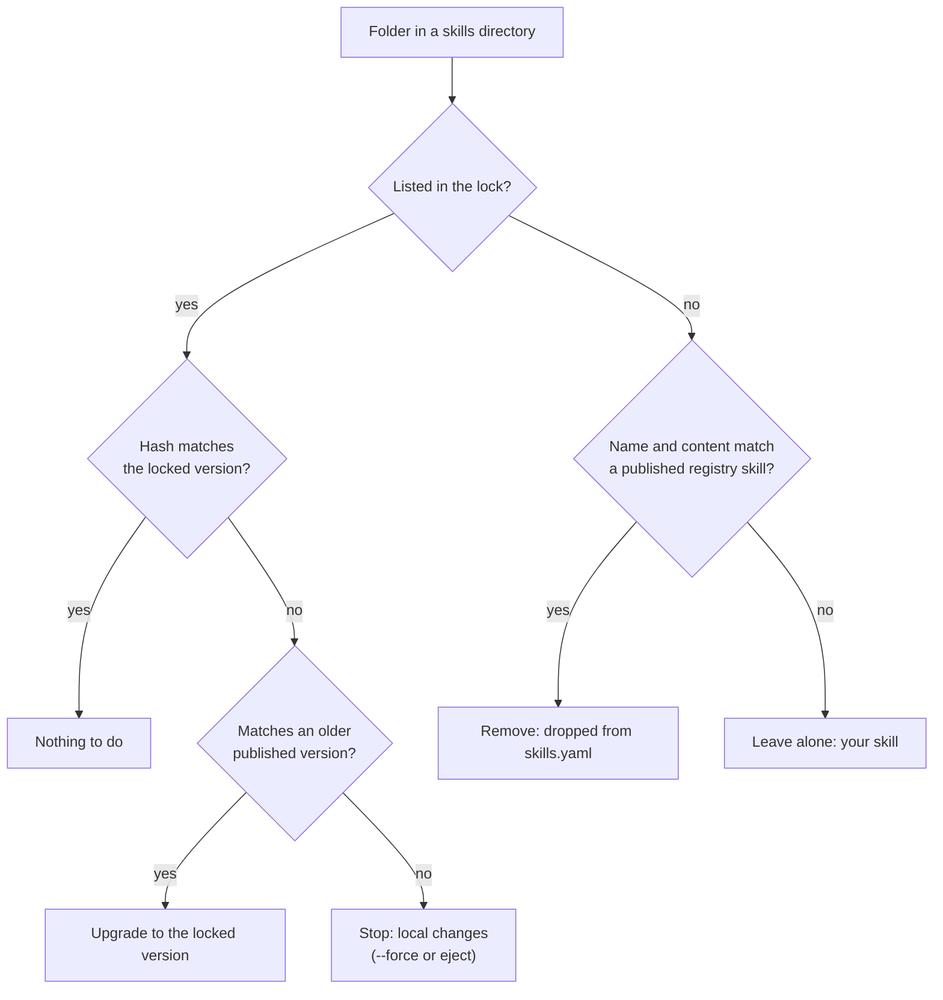

# Architecture

`add` and `update` resolve `install` against the registry mirror and write `lock`. `sync` compares the lock with the skill folders on disk and applies only the steps it can prove are safe: install, upgrade, link, unlink, remove.

## Safety model

The lock is the only state mestiere keeps. There's no hidden database or marker file to get out of sync. Before replacing or deleting a folder, mestiere checks the folder itself:

1. It computes the git tree hash of the folder on disk, skipping hidden files such as `.DS_Store` and editor swap files.
2. It looks up the registry skill that matches the folder's name, and every version that skill has had in the registry's history.
3. Only if the hash matches one of those versions is the folder an untouched install, and only then is it safe to replace or remove.

Everything else is reported and left alone: local edits, your own skills, and renamed or customized copies. `--force` is always an explicit choice. The same check makes routine team workflows work without extra steps:

| Situation | Result |
|---|---|
| A teammate updates a skill; you pull and run `sync` | Your older, unmodified copy is upgraded |
| A teammate removes a skill; you pull and run `sync` | The leftover folder is removed |
| You edited an installed skill | `sync` stops and suggests `--force` or `eject` |
| You copied a skill to make your own | The copy is never touched |
| Offline, with a cached registry | `sync` installs from the cache |

## Packages

All code lives in `internal/`:

| Package | Responsibility |
|---|---|
| `cli` | Cobra commands, output, interactive pickers |
| `project` | Resolving `install` into the lock, sync, status, doctor, add/remove/update/eject/track |
| `registry` | Bare mirrors, catalog, materializing skills with shared files, history lookups, cache |
| `manifest` | `skills.yaml` read and write with comments preserved |
| `fsx` | Git-compatible tree hashing, on disk and from object IDs; safe copy and replace |
| `gitignore` | The default rule and per-skill exceptions, checked through `git check-ignore` |
| `authoring` | Registry scaffolding and lint |
| `naming`, `skillmd`, `agents` | Name rules, `SKILL.md` frontmatter, the harness table |

## Design decisions

- **The system `git` binary, not a Go git library**, so authentication works exactly as it does for the user's own `git`.
- **Git tree hashes as content identity.** A skill's identity is the tree ID of its installed folder, so changes are detected per skill. For skills without shared links it's the registry's own tree ID.
- **History as proof of ownership.** Ownership is never recorded in a state file. It's decided by whether a folder's content was ever published.
- **Flat installs, namespaced registries.** Harnesses discover skills one level deep, so namespaces exist in the registry and in the installed names, not as folders.
- **Writes go through a temporary sibling folder,** which is then renamed into place, so an interrupted run never leaves a half-written skill.
